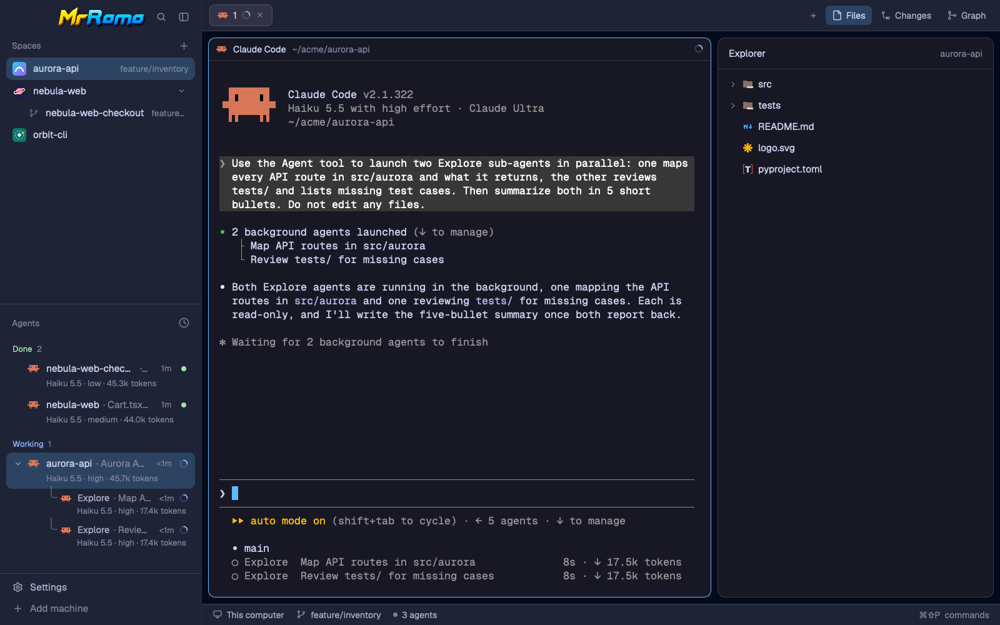
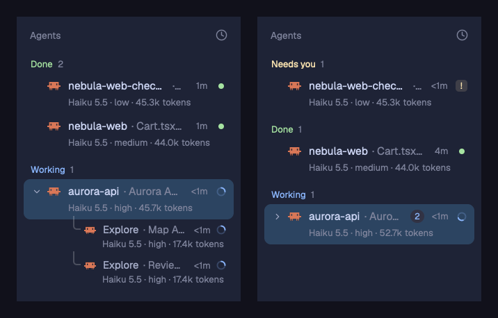
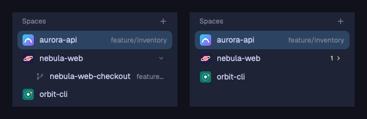
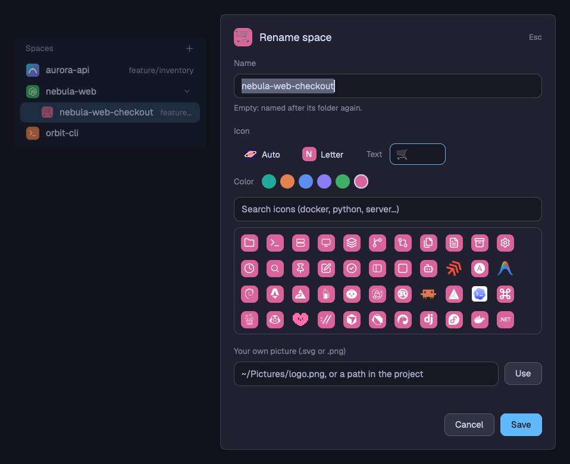
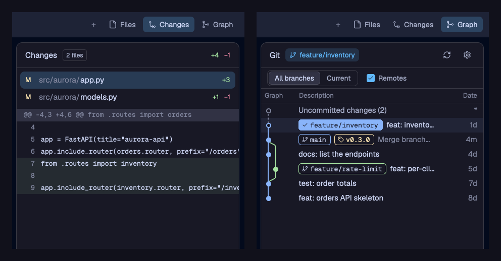
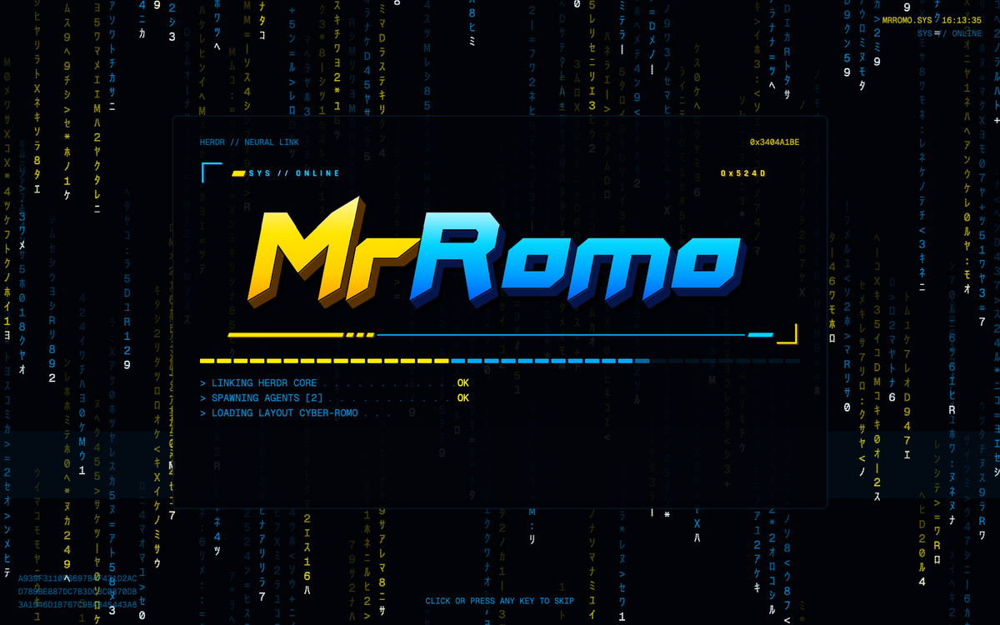

# cyber-romo

El entorno de [Herdr](https://herdr.dev) de MrRomo, listo para instalar en otro Herdr: el layout
(basado en catppuccin) con su tema, sus fuentes, los mods propios y los de terceros, y las teclas
y ajustes.



## Qué hace

### Agentes: modelo, esfuerzo, tokens y sub-agentes



- Debajo de cada Claude Code: `modelo · esfuerzo · tokens de contexto` (por ejemplo `Haiku 5.5 · high · 45.7k tokens`).
- Los sub-agentes de Claude (los que lanza con la herramienta Agent, que no tienen terminal propia)
  aparecen debajo de su agente mientras trabajan, con su tipo, su tarea, el tiempo y su propia línea
  de modelo y tokens.
- El botón ▾/▸ pliega los hijos de un agente; plegado, un contador dice cuántos son, con el color
  del más urgente (izquierda: abierto; derecha: plegado, con `2`).
- Agrupa por estado: **Needs you** (espera una respuesta), **Done** (terminó sin que lo vieras),
  **Working**, **Idle**.
- Muestra también las sesiones de Claude en segundo plano (`claude attach`), que Herdr no lista.
- Funciona con agentes en máquinas remotas (`hc machine add`); si una máquina no responde, sus
  agentes se ocultan hasta que vuelve.
- Después de compactar (`/compact`) muestra un estimado (`~62k`) hasta la siguiente respuesta, o el
  total exacto si corres `/context`.

### Espacios: íconos de proyecto, ícono a elección y worktrees



- Cada espacio lleva el ícono del proyecto (`logo.svg`, `icon.png`, `public/favicon.svg`, …) o un
  avatar de color.
- Los worktrees de git aparecen debajo de su repo; el botón los pliega y deja un contador.

**Renombrar con ícono y color.** Clic derecho en un espacio › **Rename** (o `shift-f2`) abre un
diálogo con el nombre, el ícono y el color:



- **Auto**: el ícono del proyecto, o la inicial si no tiene.
- **Letter**: la inicial aunque el proyecto tenga ícono.
- **Text**: una o dos letras o un emoji (`OC`, `🚀`).
- **Íconos de Herdr**: más de 130 (docker, python, node, go, kubectl, terminal, server, …),
  con buscador; se tiñen con el color del espacio.
- **Imagen propia**: la ruta a un `.svg` o `.png` (`~/Pictures/logo.png`, o relativa al proyecto).
  Se copia a la carpeta de Herdr, así que puedes mover o borrar el original.
- **Color**: seis tonos para el fondo de la letra, el texto o el ícono.
- Con el nombre vacío, el espacio vuelve a llamarse como su carpeta.
- Vale también para worktrees y espacios de máquinas remotas. Se guarda en el `shared.json` de
  esta instalación de Herdr (`space.icons`, `space.colors`) y la imagen en `data/space-rename/`.

### Paneles: Files, Changes y Graph



- Pestañas en píldoras y tres botones a la derecha: **Files** (explorador y editor con pestañas,
  `file-editor`), **Changes** (los cambios sin commit, de Herdr) y **Graph** (grafo de git con
  acciones, `git-graph`).

### Marca



- Barra de título con el logo MrRomo, búsqueda y plegado de la barra lateral (`brand-chrome`), y un
  splash animado al abrir (`brand-splash`). Fuente Orbitrox (Orbitron Black, OFL).

Las capturas son de una instalación limpia con proyectos de ejemplo (`aurora-api`, `nebula-web`,
`orbit-cli`) y agentes Claude Haiku de prueba.

## Qué trae

| Pieza | Qué es | Origen | En este repo |
|---|---|---|---|
| `layouts/cyber-romo.json` | La ventana completa: barra lateral (marca, espacios, agentes, pie), barra de pestañas, paneles, panel derecho (Files, Changes, Graph) y barra de estado | catppuccin de MarcozVD, con cambios | sí |
| `mods/agents-claude` | La lista de agentes descrita arriba | propio (clon de `agents` de Herdr) | sí |
| `mods/brand-chrome` | Barra de título con el logo MrRomo | propio (clon de `workspace-chrome`) | sí |
| `mods/brand-title` | Fuente Orbitrox que usan brand-chrome y brand-splash | propio; Orbitron bajo OFL | sí |
| `mods/brand-splash` | Splash MrRomo | propio | sí |
| `mods/space-rename` | Diálogo para renombrar un espacio y elegir su ícono y color | propio | sí |
| `mods/space-menu` | Menú del clic derecho en un espacio; su Rename abre space-rename | propio (copia del `menu` de Herdr) | sí |
| `mods/git-graph` | Grafo de git y acciones (panel Graph) | [rabeeh-ta/herdr-git-graph](https://github.com/rabeeh-ta/herdr-git-graph), MIT | sí (`licenses/git-graph-MIT.txt`) |
| `file-editor` | Explorador y editor con pestañas (panel Files) | [werlang/herdr-file-editor](https://github.com/werlang/herdr-file-editor) v0.1.1 | **no**: se descarga |
| `spaces-icons` | Espacios con ícono, worktrees bajo su repo; el parche agrega el ícono elegido, el menú propio, `shift-f2` y conserva los colores al reiniciar | [MarcozVD/herdr-layout-catppuccin](https://github.com/MarcozVD/herdr-layout-catppuccin) + `patches/spaces-icons.patch` | **no**: se descarga y se parcha |
| `tabs-graph` | Pestañas en píldoras + Files / Changes / Graph | MarcozVD/herdr-layout-catppuccin + `patches/tabs-graph.patch` | **no**: se descarga y se parcha |
| `herdr-catppuccin`, `herdr-catppuccin-latte` | Tema oscuro (mocha) y claro (latte); el layout sigue el modo del sistema | MarcozVD/herdr-layout-catppuccin | **no**: se descargan |
| `config/keys.json`, `config/settings.json` | Teclas (cmd-shift-l cambia de layout, cmd-d divide, `shift-f2` renombra el espacio con ícono en este layout, …) y ajustes (zoom 1.2, Geist Mono, modo oscuro, sonidos) | propios | sí |

También usa mods que **vienen con Herdr** y no se copian: `workspace-chrome` (pie de la barra
lateral), `workspace-status`, `pane`, `changes`, `files`, `menu`, `new-menu`, `toast`,
`confirm`, `prompt`, `peek`, `help`, `worktree` y `machine-add`. Los íconos de programas y las
fuentes Geist / Geist Mono / JetBrains Mono también vienen con Herdr.

## Requisitos

- Herdr app (hecho con `herdr-app 0.1.15`, `hc 0.1.20`). Abrirlo una vez crea `~/.config/herdr-app`.
- `python3` (3.6 o más) en esta máquina y en **cada máquina remota** cuyos agentes quieras ver
  con modelo y tokens (`agents-claude` corre su ayudante ahí). Sin él, la lista funciona igual,
  solo sin esa segunda línea.
- `curl`, `tar` y `patch` para bajar las piezas de terceros; `rsync` y `diff` solo para `export.sh`.
- Internet al instalar (GitHub).

## Instalar

```sh
git clone https://github.com/MrRomo/cyber-romo ~/code/cyber-romo
cd ~/code/cyber-romo
./install.sh --dry-run   # qué cambiaría
./install.sh --switch    # instala y muestra el layout
```

- Copia los mods y el layout de este repo a `~/.config/herdr-app` (o `$HERDR_HOME`).
- Baja cada pieza de `third-party.json` del repo de su autor, en el commit fijado, y le aplica el
  parche de `patches/` cuando lo tiene.
- **Fusiona** `keys.json` y `settings.json`: lo que ya tengas se queda, y en un choque gana este
  paquete. `--no-config` los deja intactos.
- Antes de reemplazar algo, lo copia a `~/.config/herdr-app-backups/cyber-romo-<fecha>/`.
- Pasa `herdr-app check` a cada mod y avisa si falta un mod de Herdr.
- Cambiar de layout: `cmd-shift-l`, o `herdr-app do layout.switch --name cyber-romo`.

Si no ves los botones Files y Changes: los muestra según los paneles que elegiste en la bienvenida
de Herdr (`workspace.panels` en `shared.json`).

Para deshacerlo, copia de vuelta el contenido de la carpeta de respaldo que indica el
instalador, o borra `layouts/cyber-romo.*` y los mods de la tabla.

## Piezas de terceros (para agentes)

`file-editor`, `spaces-icons`, `tabs-graph` y los dos temas catppuccin no declaran licencia, así
que este repo no los copia. `third-party.json` dice de dónde sale cada uno:

```json
{ "name": "spaces-icons", "kind": "mod",
  "repo": "MarcozVD/herdr-layout-catppuccin", "commit": "b58f434…",
  "path": "mods/spaces-icons", "patch": "patches/spaces-icons.patch" }
```

`install.sh` lo hace solo. Un agente puede hacerlo a mano, para cada entrada:

1. Bajar el repo en ese commit:
   `curl -fsSL https://codeload.github.com/<repo>/tar.gz/<commit> | tar xzf - --strip-components 1 -C <carpeta>`.
2. Copiar `<carpeta>/<path>`:
   - un mod (`kind: mod`): a `~/.config/herdr-app/mods/<name>/`. Primero arma la carpeta afuera y
     muévela entera: Herdr acopla al layout un mod que ve sin su `mod.json`.
   - un tema (`kind: theme`): a `~/.config/herdr-app/themes/<name>.json`.
3. Si tiene `patch`, aplicarlo dentro de la carpeta del mod: `patch -p1 -d mods/<name> < patches/<name>.patch`.
4. `herdr-app check ~/.config/herdr-app/mods/<name>`.

| Pieza | Repo | Commit |
|---|---|---|
| `file-editor` | [werlang/herdr-file-editor](https://github.com/werlang/herdr-file-editor) | `ab5bceb4d53f876637451de83a8469994c5fd8b0` |
| `spaces-icons`, `tabs-graph`, `herdr-catppuccin`, `herdr-catppuccin-latte` | [MarcozVD/herdr-layout-catppuccin](https://github.com/MarcozVD/herdr-layout-catppuccin) | `b58f43478fbf874c8be989b3336793f7c98b6d10` |

## Actualizar este repo desde el entorno

Después de cambiar algo en Herdr (un mod, el layout, el tema):

```sh
./export.sh        # copia desde layouts/catppuccin.json y los mods del manifiesto
git diff && git commit -am "..."
```

- Los mods de `MODS` (en `manifest.sh`) se copian tal cual.
- De las piezas de `third-party.json` guarda solo la diferencia con el commit de su autor, como
  parche en `patches/`. Si un tema cambió, avisa: el parche solo cubre mods.
- Avisa si el layout usa un mod o tema que no está en el manifiesto ni en `third-party.json`.
- Para exportar desde otro layout: `LAYOUT_SRC=otro ./export.sh`.

Para subir una pieza de terceros a una versión nueva de su autor: cambia su `commit` en
`third-party.json`, corre `./export.sh` y revisa el parche que queda.

## Cómo funciona agents-claude

- Herdr solo ve como agentes las terminales que reportan su estado. Una sesión de Claude en
  segundo plano (`claude attach <id>`) no lo reporta, así que el mod la encuentra por su cuenta.
- Los agentes de una máquina remota desconectada o inalcanzable no se muestran: Herdr deja en
  pantalla los últimos que vio, congelados. Mientras no responda, el mod no intenta conectarse;
  la revisa cada 3 s y sus agentes vuelven en cuanto está de nuevo conectada.
- Los tokens son el contexto de la última respuesta. Si después la sesión se compactó, la fila
  muestra un estimado (`~62k`: lo que queda tras compactar más la parte fija de la sesión); si
  después corriste `/context`, muestra el total que este dio. Con la siguiente respuesta vuelve
  a ser exacto.
- En cada máquina corre un vigilante (`claude-info.py --watch`): mira cada 250 ms la fecha de
  los archivos de Claude (`~/.claude/sessions`, transcripts, sub-agentes) y, cuando cambian,
  escribe `~/.cache/herdr-agents-claude/state.json` (como mucho una vez por segundo, y un
  latido cada 15 s). El mod lo lee al instante en local y cada 1–3 s en remoto.
- Medido: 0,24 % de un núcleo y 28 MB en local, 0,04 % y 19 MB en una VM; de un cambio a la
  pantalla, ~0,1 s en local.
- Protecciones:
  - Solo lee: nunca escribe en los archivos de Claude ni en las terminales.
  - Hay un solo vigilante por máquina.
  - Sale solo cuando muere quien lo lanzó, a los 9 min, o si se acumulan errores
    (`~/.cache/herdr-agents-claude/error.log`).
  - Si falla, espera cada vez más antes de reintentar (2 a 60 s). Tras 3 fallos pasa a
    consultar cada 5–10 s.

## Qué no incluye (es de cada máquina)

Los espacios y pestañas abiertos, los colores de cada espacio, tamaños y clics guardados
(`layouts/.state`), cachés y estado de los mods (`data/`, `cache/`), máquinas remotas
(`hc machine add`) y los agentes instalados (Claude Code, etc.).

## Créditos

- Layout, `spaces-icons`, `tabs-graph` y temas catppuccin: [MarcozVD/herdr-layout-catppuccin](https://github.com/MarcozVD/herdr-layout-catppuccin).
- `file-editor`: [werlang/herdr-file-editor](https://github.com/werlang/herdr-file-editor).
- `git-graph`: [rabeeh-ta/herdr-git-graph](https://github.com/rabeeh-ta/herdr-git-graph), MIT (`licenses/git-graph-MIT.txt`); íconos según Lucide (ISC).
- Orbitron: The League of Moveable Type, SIL Open Font License 1.1 (`mods/brand-title/fonts/LICENSE-Orbitron.txt`).
- Herdr y sus mods de base: [herdr.dev](https://herdr.dev).
